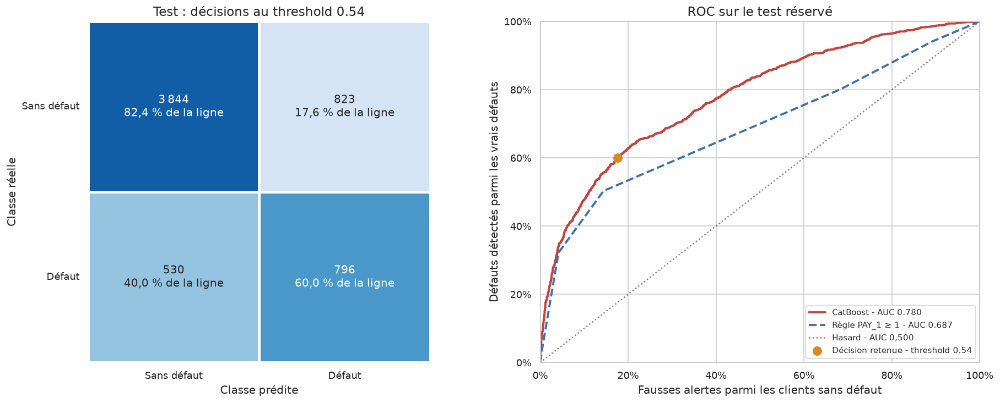

# Prédiction du défaut de paiement

**Projet de data science — Ryan Routier**  
Analyse du risque de défaut de clients de cartes de crédit : exploration, préparation des données, comparaison de modèles et interprétation des prédictions.

**Résultat principal :** CatBoost obtient une ROC-AUC de **0,780 sur le test réservé**, après sélection par validation croisée imbriquée et choix du seuil sur l’entraînement.

[Consulter le notebook complet](notebooks/prediction_credit_default_actualise2.ipynb) · [Méthodologie](docs/methodology.md) · [Profil GitHub](https://github.com/Ryan31320)

## Objectif

Prédire le défaut de paiement du mois suivant à partir du profil client et de six mois d’historique de crédit. L’étude examine le compromis entre défauts détectés et fausses alertes, dans un jeu de données où environ 22 % des clients font défaut.

## Travail réalisé

- Exploration des distributions, des catégories et des comportements de remboursement sur le train.
- Nettoyage des données, séparation stratifiée train/test et création de cinq variables explicatives.
- Comparaison de baselines et de modèles de classification : régression logistique, KNN, Bayes naïf, SVM, arbres, forêts, boosting et réseau de neurones.
- Optimisation de dix familles avec **Optuna**, selon une validation croisée imbriquée **5 × 5 plis**, avec **50 essais par recherche**.
- Comparaison d’un ensemble par soft voting et sélection du seuil par F1 sur les prédictions hors pli du train.
- Analyse des erreurs, calibration et interprétation par permutation, dépendances partielles et SHAP de CatBoost.

**Technologies :** Python · pandas · NumPy · scikit-learn · Optuna · CatBoost · XGBoost · LightGBM · Matplotlib · Seaborn · Jupyter.

## Résultats

Les valeurs ci-dessous sont les résultats enregistrés dans le notebook d’origine. Le benchmark complet n’a pas été réexécuté lors de la préparation du dépôt.

| Modèle | ROC-AUC externe moyenne | Écart-type entre plis |
|---|---:|---:|
| CatBoost | 0,7897 | 0,0101 |
| XGBoost | 0,7890 | 0,0102 |
| LightGBM | 0,7888 | 0,0094 |
| HistGradientBoosting | 0,7883 | 0,0097 |
| Random forest | 0,7877 | 0,0097 |

Les écarts sont faibles ; ce classement ne démontre pas une supériorité générale de CatBoost.

Après réentraînement de CatBoost, au seuil d’environ **0,54** choisi sur le train :

| Évaluation sur 5 993 observations de test | ROC-AUC | Precision | Recall | F1 | Accuracy |
|---|---:|---:|---:|---:|---:|
| CatBoost | **0,780** | 0,492 | **0,600** | **0,541** | 0,774 |
| Règle de référence `PAY_1 ≥ 1` | 0,687 | 0,498 | 0,503 | 0,501 | 0,778 |

La ROC-AUC de la référence est calculée avec le score ordinal `PAY_1` ; ses métriques de décision utilisent le seuil 1. Le modèle améliore la détection des défauts et le F1, avec davantage de fausses alertes. Environ une alerte sur deux correspond à un défaut.



## Données

[Default of Credit Card Clients — UCI Machine Learning Repository](https://archive.ics.uci.edu/dataset/350/default+of+credit+card+clients), Yeh (2009), DOI [10.24432/C55S3H](https://doi.org/10.24432/C55S3H).

- 30 000 clients d’une banque à Taïwan, historique d’avril à septembre 2005.
- 23 variables explicatives, un identifiant et une cible binaire.
- 29 965 lignes après suppression de 35 doublons hors identifiant.
- 23 972 observations d’entraînement et 5 993 de test.

Le fichier source est téléchargé automatiquement par le notebook. Les données et les caches de calcul ne sont pas inclus dans Git.

## Structure

```text
credit-default-risk-analysis/
├── notebooks/
│   └── prediction_credit_default_actualise2.ipynb
├── data/                       # Données téléchargées localement
├── reports/
│   └── figures/                # Graphiques extraits de l’étude
├── docs/
│   └── methodology.md          # Protocole et limites
├── scripts/
│   └── validate_notebook.py    # Validation du format et de la syntaxe
├── .github/workflows/
│   └── validate.yml            # Contrôle automatique du notebook
├── requirements.txt
├── .python-version
└── .gitignore
```

Le notebook conserve le déroulement complet de l’étude et ses fonctions de tuning. Cette structure permet de lire les résultats directement et de relancer l’analyse sans dépendre d’un autre dépôt.

## Installation et exécution

Avec **Python 3.12**, depuis la racine du projet :

```bash
python3.12 -m venv .venv
source .venv/bin/activate
python -m pip install --upgrade pip
python -m pip install -r requirements.txt
python -m ipykernel install --user --name credit-default-risk --display-name "Python (credit-default-risk)"
python -m jupyterlab
```

Sous Windows, activer l’environnement avec `.venv\Scripts\Activate.ps1` dans PowerShell.

Ouvrir `notebooks/prediction_credit_default_actualise2.ipynb`, sélectionner le kernel **Python (credit-default-risk)** puis exécuter les cellules dans l’ordre. Les chemins sont adaptés à un lancement depuis la racine ou `notebooks/`.

Les résultats sont déjà visibles sans exécution. Une réexécution complète est coûteuse : **12 500 entraînements internes** pour la validation imbriquée, auxquels s’ajoutent les refits et la recherche finale. La durée dépend du CPU. Le cache Optuna est créé localement dans `.actualise2_cache/` et permet la reprise des recherches. Modifier les versions, les données ou le protocole peut modifier les résultats ; repartir d’un cache vide dans ce cas.

Pour vérifier la structure et la syntaxe sans entraîner les modèles :

```bash
python scripts/validate_notebook.py
```

## Limites et pistes d’amélioration

Les données datent de 2005 et une séparation aléatoire ne mesure pas la stabilité temporelle. La pondération des classes déforme les probabilités : une recalibration est nécessaire avant de les lire comme des risques absolus. Le seuil F1 doit aussi être confronté aux coûts métier. Une validation sur une autre population, une étude des erreurs par groupes et un suivi de dérive prolongeraient ce travail.

L’analyse complète des limites figure dans le [document méthodologique](docs/methodology.md) et dans le notebook.
